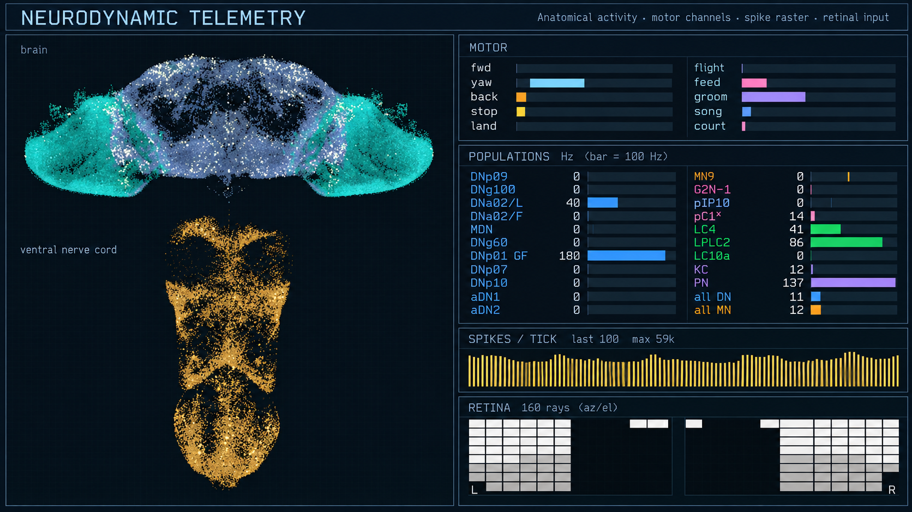
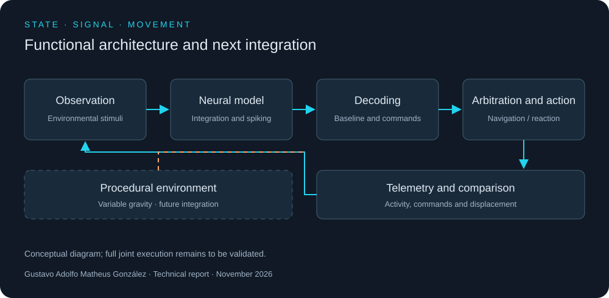
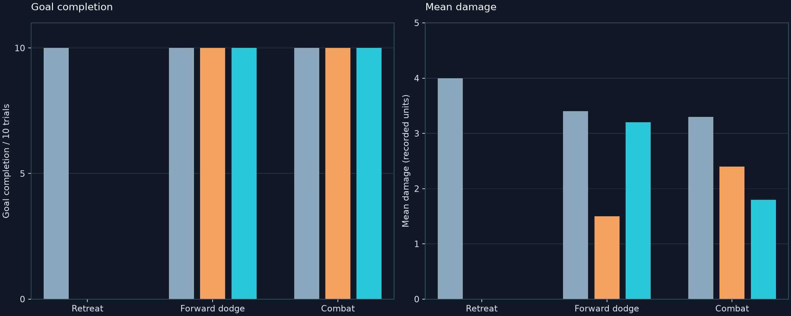
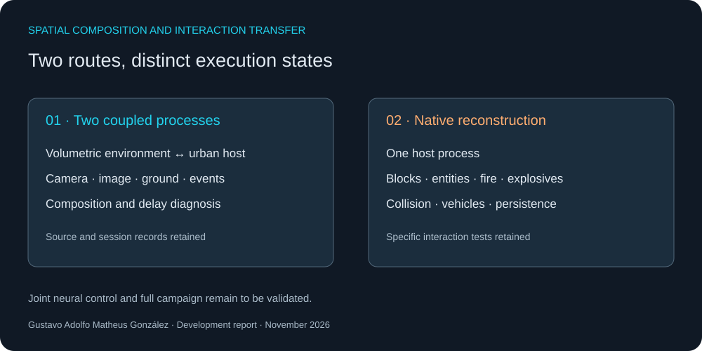

# Coupled Neurodynamic Control and Cross-Environment Spatial Emulation

### An experimental report on sensorimotor decoding, process synchronization, and procedural scene construction

**Gustavo Adolfo Matheus González · GMProspect**
1 November 2026 · Development and experimental records reviewed: 7–27 October 2026

## Abstract

This report examines a computational system in which three problems converge: the translation of simulated neural activity into motor commands, the coordination of spatially heterogeneous interactive processes, and the construction of a controllable three-dimensional scene. The investigation is organized around a common question: whether an observed action can be traced, without ambiguity, from the stimulus that initiated it through the intermediate state estimates and control decisions to the displacement or visual event ultimately recorded.

The available evidence comprises a connectome-based spiking model, a corrected motor-decoder calibration, repeated comparisons of reflex policies, an interprocess spatial bridge, a second implementation that reconstructs selected mechanics within a single host process, and a separate procedural scene prototype. These components have different levels of validation. In particular, the neural controller has been evaluated in an embodied navigation setting, and the spatial bridge has been exercised in its host environment; the record does not establish that the neural controller has completed a campaign task inside the combined environment. The purpose of this report is to specify what was built, what was measured, and what remains open.

*Figure 1. Interface reconstruction based on the two reference captures. The anatomical display, motor channels, spike raster, and retinal matrices are presented without the original scene background. Small labels and values in this recreated image must not be used as measured data; the quantitative results in this report come from retained test and trial records. Reference interface and anatomical display: [underlying implementation](https://github.com/blendi-remade/fly-brain-minecraft).*

*Figure 2. Functional organization of stimulus acquisition, neural state evolution, motor decoding, arbitration, actuation, and telemetry. The procedural environment is shown as a prospective extension of the same control loop.*

## 1. Neurodynamic substrate and observability

The neural subsystem uses a leaky integrate-and-fire approximation over a processed anatomical connectivity dataset. Its local provenance records **176,422 neurons, 6,287,749 retained directed connections, and 90,296,905 synaptic contacts represented by the connection weights**. These quantities describe different levels of the data representation. Connections below a five-contact threshold and self-connections were removed during preparation. The numbers characterize the model used in this experiment; they do not constitute a new anatomical reconstruction. The dataset and preprocessing are documented in the [source provenance record](https://github.com/blendi-remade/fly-brain-minecraft/blob/main/PROVENANCE.md).

Sensory populations receive encoded environmental signals. The evolving membrane states generate spike events, which propagate through weighted links. Activity in selected descending populations is then reduced to motor channels. This reduction is an engineering choice: a biologically derived spike pattern does not, by itself, define a unique physical action. The decoding rule, gains, fallback behavior, and arbitration policy must therefore remain observable as distinct parts of the system.

The model includes both anatomical and functional displays. They assist inspection of regional activation and descending populations, while quantitative claims rely on retained traces and explicit test conditions. A visual display alone cannot distinguish an activity fluctuation from a change in body trajectory.

## 2. Tonic asymmetry and decoder calibration

Under a bilateral olfactory stimulus applied at equal nominal rates per receptor, the recorded descending turning populations exhibited unequal sustained responses. The resulting yaw command showed a persistent directional bias. Equal nominal stimulation does not imply identical spike trains, equal aggregate input, or a uniquely identified physiological cause. The observation is consequently treated as a property of this model under the tested configuration.

To compensate for a tonic component without editing the anatomical connection weights, the motor decoder maintains a slowly varying baseline **B(t)** for its pre-compensation command **u(t)**:

**dB/dt = [u(t) − B(t)] / τ**, with **τ = 3 s**.

Following a one-second initialization interval, the turning command is evaluated against that baseline. Review of an earlier implementation found that the initial average included the startup ramp of a separate smoothing stage. A constant input was therefore underestimated during calibration and reappeared as a transient residual turn. The revised implementation estimates its initial baseline from the unsmoothed signal and confines the adaptation to the investigated yaw channel.

The retained test report contains **14 executed cases, zero failures, and zero errors**. Deterministic stimuli of both signs were added to bound the integrated command after initialization. Its unit is **normalized yaw-command seconds**; an angle in radians would require the actuator gain and the duration for which that gain was applied. These tests establish the behavior of the decoder under their specified inputs. They do not establish a biological correction or prove the trajectory of the complete embodied system.

The adaptive filter has a consequential limitation: a legitimate sustained turn is attenuated along with tonic bias. Withdrawal of a persistent input can also produce a transient command in the opposite direction. Those effects remain part of the model and motivate trials that separately measure raw activity, filtered command, body state, and final path.

## 3. Reflex arbitration and comparative trials

The control stack separates target selection, navigation execution, and reflex intervention. A goal-directed executor can reach a specified location, while activity from the neural model can interrupt the planned trajectory. An early navigation trial recorded arrival in **8.2 s**. That result verifies one execution of the navigation mechanism; it does not assign path planning to the neural model.

Subsequent experiments compared a baseline without reflex intervention, a programmed reflex, and a reflex initiated by the neural readout. Three principal series comprised **40, 30, and 30 trials**, respectively. In the first, retreat reduced recorded damage but repeatedly prevented progress toward the target. The failure was architectural: a pursuing threat induced repeated interruption and replanning. A revised forward-biased dodge restored goal completion in all three conditions, with **10/10 arrivals per condition** in the second series. Mean damage was **3.4** for the baseline, **1.5** for the programmed reflex, and **3.2** for the neural trigger.

The third series introduced combat. All three conditions reached the target in **10/10 trials**. Mean damage was **3.3**, **2.4**, and **1.8**, in the same order. The predeclared comparison did **not** establish a neural advantage over the programmed policy: the measured difference between those two conditions had **p = 0.6275** under the recorded permutation analysis. The experiment used a single model seed, one threat class, a restricted scene, and ten main trials per condition. It supports a characterization of this control arrangement, not a general ranking of biological and programmed reflexes.

*Figure 3. Results transcribed from the retained analyses for the three principal series. Each plotted condition contains ten trials. The first series shows why damage reduction cannot be interpreted without goal completion; the later series show the effect of changing the arbitration policy. Gray denotes no reflex; orange denotes a programmed reflex; cyan denotes a neural trigger. Bars are descriptive means, not uncertainty intervals.*

The source of each action matters. The neural subsystem supplied an escape trigger; the path executor selected the route, and the combat layer selected a target. A behavioral outcome cannot be assigned to the neural readout without accounting for those downstream rules.

## 4. Spatial coupling across heterogeneous environments

The spatial work followed two complementary routes. The first coordinates **two running interactive processes**. It exchanges camera pose, orientation, local ground reference, input events, and selected object interactions. A frame produced in a discrete volumetric environment is registered against the view of a continuous urban host. The bridge also translates actions involving world objects, inventory, collision, and vehicles. The integration adapts an existing [open-source interprocess example](https://github.com/rehan-remade/universal-modder); the host-specific implementation and subsequent native route are distinct local developments.

This arrangement requires a transformation between coordinate frames, an explicit convention for handedness and scale, and temporal alignment between the image acquisition pose and the pose at presentation. A diagnostic session on 27 October retained **244 seconds** of observation. The composed image was typically **one host frame behind**, with a recorded maximum of five frames. When the camera rotated, that delay appeared as a spatial displacement of otherwise stationary geometry. A rotational reprojection was then implemented and its coordinate calculations and shader compilation checked outside the running host. The reviewed record does not establish its final in-host error distribution; it also does not justify a submillisecond latency claim.

The second route reconstructs selected volumetric mechanics **inside one host process**. The local implementation includes block placement and removal, collision handling, a material-selection interface, first-person presentation, reactive entities, fire, and chained explosive events. Tests retained from 26 October cover concrete interactions: three successive explosive events, measured damage to entities, entry and exit from vehicles, and recovery of a construction after saving and restarting. Isolated tests also exercise geometry, persistence formats, asset integrity, update and restoration behavior. This is a functional, bounded implementation. Broad campaign and interior compatibility remain open.

*Figure 4. Architectural routes represented from local source and validation records: interprocess composition and in-process reconstruction. The diagram is explanatory and is not a screen capture or a performance measurement.*

The existence of these routes establishes more than a communication bridge: geometry, materials, interaction semantics, camera behavior, collision rules, persistence, and failure recovery were recreated or adapted as part of the spatial system. It does not establish that every mechanic of either original environment has been reproduced.

## 5. Automated verification and reproducibility boundary

The investigation includes repeatable scripts for stimulus presentation, navigation, reflex-policy comparison, installation, restoration, and live-state observation. The neural trials retain condition-level summaries and per-run traces. The spatial route uses bounded probes attached to a verified host process and records acknowledged actions alongside observed state. Isolated tests inspect file formats, collision geometry, persistence, and recovery after simulated failures.

These mechanisms answer different questions. A deterministic decoder test establishes a transfer rule. A file-level regression test establishes preservation of bytes or structure. A live probe establishes that a selected action reached a running process under a particular configuration. None substitutes for a controlled observation of a full mission or for long-duration compatibility across all scenes. The report therefore preserves the separation between executed trials, isolated checks, and prepared components awaiting in-environment evaluation.

## 6. Procedural scene construction

A further prototype constructs scene geometry, lighting, camera, player representation, interaction device, and interface elements at runtime. A surface-normal selection determines the direction of attraction or repulsion; the body and camera reorient progressively to a new local vertical. The prototype also implements locomotion, jumping, and recovery after leaving the playable region.

This work is a procedural scene system built on an existing graphics and physics runtime. Its significance for the larger investigation is methodological: it offers a controllable space in which orientation, sensory encoding, actuation, and visual feedback could be studied under explicit conditions. A coupling between this prototype and the full neural controller remains a future integration task. The prototype does not constitute evidence of an independent rendering engine.

## 7. Interpretation and next measurements

The present results support three limited conclusions. First, the neural output can be monitored, decoded, and used as a reflex trigger in an embodied control experiment. Second, a heterogeneous spatial scene can be represented through synchronized processes, while selected mechanics can also be reconstructed within a single host. Third, automated traces can expose failures that a convincing visual demonstration would conceal, including a reflex policy that prevents goal completion and a frame of camera-pose delay.

The next evaluation should retain stimulus, neural activity, unfiltered command, baseline estimate, final command, arbitration decision, process timing, and realized trajectory in one aligned record. It should vary the adaptation, reflex policy, and navigation executor separately, then test the combined spatial system under explicitly defined scenes. A claim of autonomous task completion or clinical relevance would require additional evidence beyond the experiments reported here.

The generalizable contribution is the measurement discipline: an apparent response becomes interpretable only when the state transitions producing it can be reconstructed. That discipline also makes a negative result useful, because it identifies which layer must be changed and what observation would determine whether the change worked.

## Provenance and publication scope

**Report and local integration:** Gustavo Adolfo Matheus González. The neuronal codebase originate from the [underlying research implementation](https://github.com/blendi-remade/fly-brain-minecraft); its code and processed data carry MIT and CC BY 4.0 terms, respectively. The anatomical dataset is from the [Male CNS project](https://male-cns.janelia.org/). The interprocess route adapted an [MIT-licensed reference example](https://github.com/rehan-remade/universal-modder). These citations identify underlying materials and do not assign authorship of the local integration to their maintainers.

This public report includes derived descriptions, diagrams, an illustrative interface reconstruction, and aggregate results. The implementation and full experimental record reside in a separate private repository. Commercial environment files and their extracted assets remain on the local machine.
